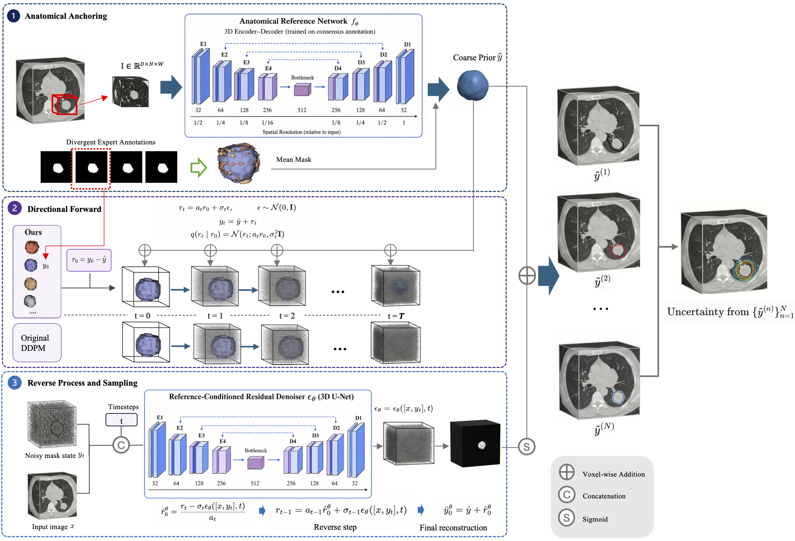
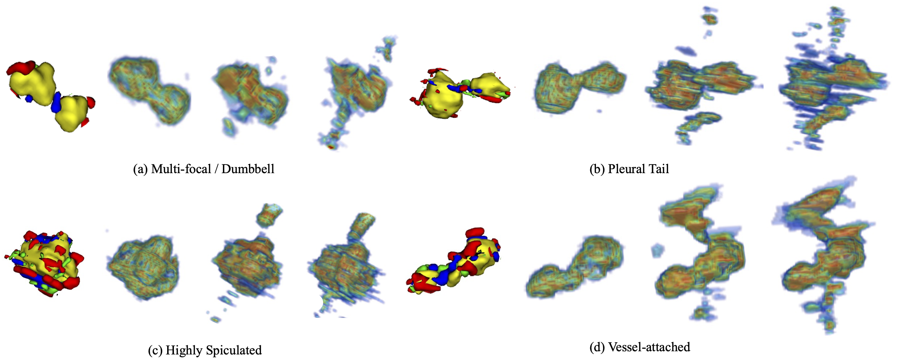

# Volumetric Directional Diffusion (VDD)

### Anchoring Uncertainty Quantification in Anatomical Consensus for Ambiguous Medical Image Segmentation

**Accepted at IEEE International Conference on Bioinformatics and Biomedicine (BIBM) 2026.**

  

---

## Overview

Ambiguous 3D medical image segmentation requires modeling clinically plausible inter-observer variability while preserving coherent volumetric anatomy.

We propose **Volumetric Directional Diffusion (VDD)**, a prior-anchored diffusion framework that shifts stochastic generation from full-mask synthesis to **residual boundary exploration**.

Instead of reconstructing an entire segmentation mask from unstructured Gaussian noise, VDD uses a coarse deterministic segmentation as an **anatomical reference** and models expert-specific deviations in residual space. This constrains stochastic exploration to ambiguous boundary regions while preserving stable global anatomical support.

---

## Method

VDD consists of three main components:

- **Anatomical Anchoring**  
  A deterministic segmentation network provides a coarse anatomical reference.

- **Directional Diffusion in Residual Space**  
  Diffusion operates on the residual between an expert annotation and the anatomical reference rather than directly on the full segmentation mask.

- **Stochastic Sampling for Uncertainty Estimation**  
  Multiple segmentation samples are generated to model plausible inter-rater variation and estimate predictive uncertainty.

---
## Experiments

We evaluate VDD on three multi-rater medical image segmentation datasets:

- **LIDC-IDRI**
- **KiTS21**
- **ISBI 2015**

All datasets are split at the patient level using an **8:1:1 train/validation/test split**.  
For stochastic methods, we use **16 samples per case** unless otherwise specified.

### Main Results

| Dataset | MaxDice ↑ | GED ↓ | CI ↑ | SNCC ↑ |
|:---|---:|---:|---:|---:|
| **LIDC-IDRI** | **0.8031** | **0.2081** | **0.6360** | **0.5322** |
| **KiTS21** | **0.9145** | **0.1956** | **0.7233** | **0.2509** |
| **ISBI 2015** | 0.6345 | **0.4798** | **0.2605** | **0.2957** |

**Bold** indicates the best result among the compared methods.

VDD achieves the best performance across all reported metrics on **LIDC-IDRI** and **KiTS21**.  
On **ISBI 2015**, VDD achieves the best GED, CI, and SNCC, while Probabilistic U-Net obtains the highest MaxDice.

### Evaluation Metrics

We evaluate the models from two complementary perspectives: **sample-to-rater agreement** and **uncertainty-disagreement alignment**.

- **MeanDice ↑** — average Dice score across all generated sample–expert annotation pairs, measuring average sample-to-rater agreement.
- **MaxDice ↑** — matches each expert annotation to its best generated sample and measures how well the generated sample set covers plausible rater-specific segmentations.
- **HD95 ↓** — 95th-percentile Hausdorff Distance, measuring volumetric boundary consistency.
- **GED ↓** — evaluates the distributional agreement between generated segmentations and expert annotations.
- **CI ↑** — evaluates the alignment between predictive uncertainty and observed expert disagreement.
- **SNCC ↑** — measures the correspondence between predictive uncertainty and inter-rater disagreement.

We additionally evaluate **3D structural consistency**, robustness to different numbers of expert annotations, and inference efficiency in terms of the number of diffusion steps, inference time, and GPU memory.

  

  <em>
    3D visualization of predictive uncertainty on representative ambiguous LIDC-IDRI nodules.
    Each case compares multi-rater ground-truth annotations with uncertainty maps from VDD, CCDM, and DiffOSeg.
  </em>

### Compared Methods

We compare VDD against representative methods covering deterministic, probabilistic, and diffusion-based segmentation:

- **nnUNet2 (2D / 3D)** — strong deterministic segmentation baselines.
- **Probabilistic U-Net (3D)** — latent-variable probabilistic segmentation.
- **CCDM (2D)** — conditional categorical diffusion for stochastic segmentation.
- **DiffOSeg (2D)** — diffusion-based multi-expert segmentation.

---

**Code coming soon.**

